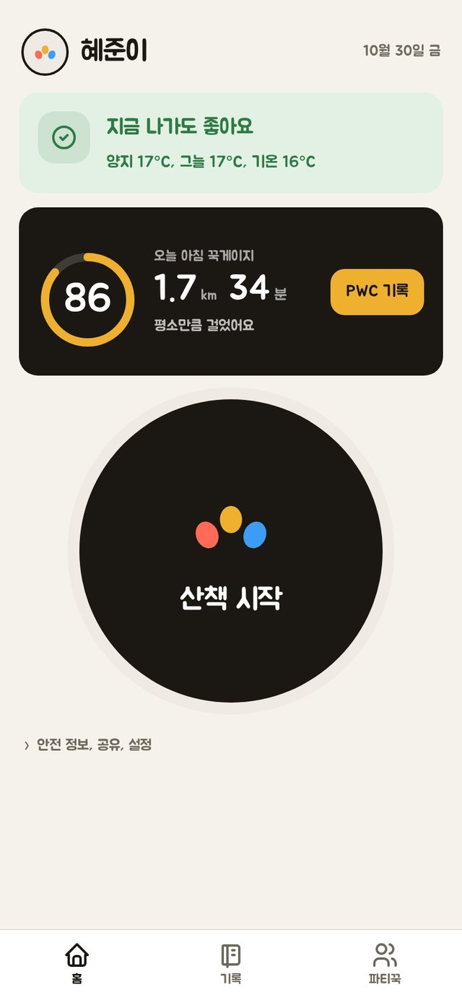
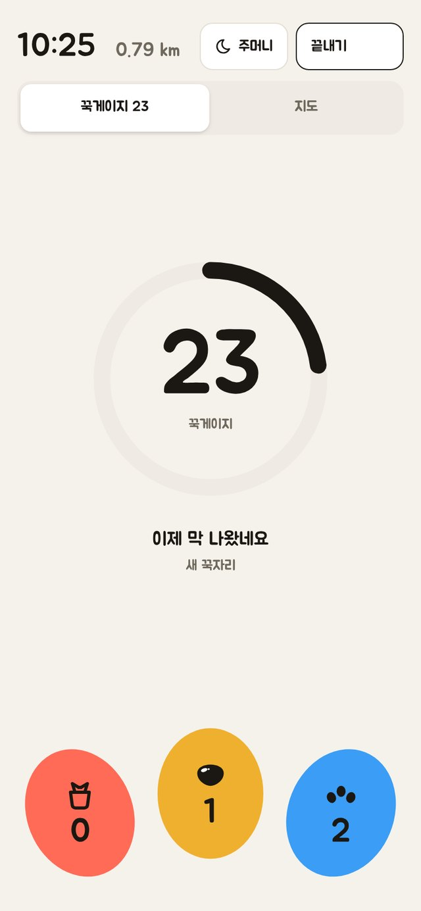
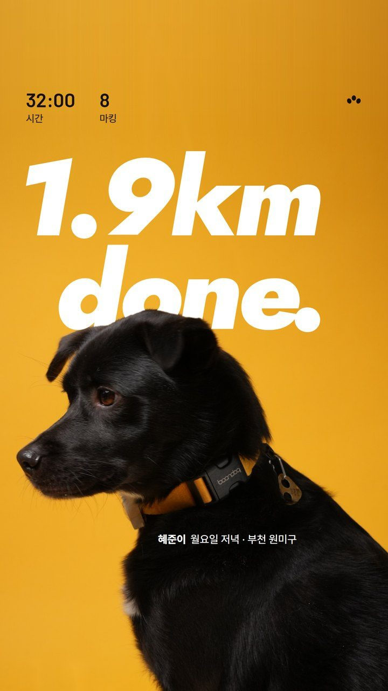

  

<h1 align="center">꾹꾹이 (PADD)</h1>

  <b>오늘 산책, 충분했을까?</b> 
  Was today's walk enough for your dog?

  <a href="https://062-sibi.github.io/kkukkkukkkuk/">웹에서 써 보기</a> |
  <a href="https://062-sibi.github.io/kkukkkukkkuk/download.html">앱 받기 (Android, iPhone)</a> |
  <a href="https://062-sibi.github.io/kkukkkukkkuk/about/">소개 페이지</a>

  
  
  

> **In English.** A free dog-walking app that tells you whether today's walk was enough. It compares the walk with your own dog's last 14 walks, not with other dogs. There is no sign-up, and walk records stay on the phone. I build it alone as a product planner without a developer background. I own the problem definition, feature scope, screens and every release decision, and I write the code with AI coding agents (Claude Code and Codex). It runs on the web, Android and iPhone (App Store).

## 무엇을 하나요

- **꾹게이지**: 걸은 시간, 냄새 맡은 시간, 소변과 대변을 모아 그 강아지의 최근 14번 산책과 견줍니다. 남의 강아지와 줄 세우지 않습니다.
- **바닥 온도**: 나가기 전에 노면 온도를 추정해 위험한 시간이면 먼저 알려 줍니다.
- **기록 카드**: 산책이 끝나면 거리와 시간, 마킹을 담은 카드를 만듭니다. 숫자는 실제로 걸은 기록에서만 나옵니다.
- **우리 동네**: 자주 가는 꾹자리와 처음 걸은 길이 지도에 남습니다.

## 기획에서 내린 결정

### 1. 출처 없는 숫자는 뺐습니다

여름 산책 전 보호자는 손등으로 바닥을 짚어 봅니다. 국내외 반려견 앱 11종을 살펴보니 노면 온도를 다루는 앱은 없었습니다.

업계에서 가장 많이 인용하는 '51.6℃에서 60초면 화상'은 1차 출처를 찾지 못해 뺐습니다. 계수는 서울 실측 논문(한국환경과학회지, 2024)에 맞춰 0.0413에서 0.031로 다시 잡았습니다. 통설대로 계산하면 8.5℃ 높게 나오던 추정을 이렇게 고쳤습니다.

근거 없는 숫자는 쓰지 않습니다. 틀려야 한다면 안전한 쪽으로 틀립니다.

### 2. 남이 아니라 그 강아지 자신과 비교합니다

꾹게이지 v3.5까지는 배점이 고정이었습니다. 대변 30점, 소변 25점, 냄새 맡기 20점, 거리 25점입니다. 하루에 대변을 한 번 보는 강아지는 두 번째 산책에서 늘 30점을 잃었습니다.

v3.6에서는 하루를 아침, 낮, 저녁으로 나눴습니다. 같은 때 최근 14회의 중앙값을 기준선으로 삼습니다. 대변은 그 시간대에 볼 확률이 50% 이상일 때만 채점합니다. 기록이 5회 미만이면 점수 대신 '기준을 배우는 중'을 보여 줍니다.

### 3. 넣은 것보다 뺀 것

| 결정 | 이유 | 대신 뺀 것 |
|---|---|---|
| 꾹게이지로 강아지의 만족을 숫자로 | 산책을 끝내는 기준은 거리가 아니라 강아지의 만족이라서 | 거리와 칼로리 중심 화면 |
| 기록은 큰 버튼 셋 | 목줄을 쥔 한 손으로 눌러야 해서 | 산책 중 입력 칸 |
| 가입 없이, 기록은 폰 안에 | 첫 사용 문턱을 낮추고 위치 기록을 지키려고 | 서버 저장 |
| 동행 매칭은 뒤로 | 사람이 모여야 도는 기능이라 혼자 써도 완결되는 앱부터 | 첫 판의 커뮤니티 기능 |

### 4. 숫자가 안 나오면 멈출 것을 먼저 정했습니다

| 지표 | 목표 | 멈춤선 | 멈춤선 아래면 |
|---|---|---|---|
| 2주 뒤 사용률 | 25% | 8% 미만 | 모집을 멈춥니다 |
| 기록 카드 공유율 | 15% | 5% 미만 | 카드를 메인 화면에서 내립니다 |
| 유료 지불 의향 | 3명 | 3명 미만 | 결제 도입을 미룹니다 |

첫 검증 기준은 산책을 한 번 이상 기록한 보호자 40명입니다. 설치 수가 아니라 실제로 걸은 사람을 셉니다. 첫 판정일은 2026년 12월 31일입니다.

## 약속

- 가입이 없습니다. 걸은 길과 꾹자리, 사진은 폰 밖으로 나가지 않습니다.
- 날씨(Open-Meteo)와 동네 이름(OpenStreetMap Nominatim)을 받을 때만 대략적인 위치를 보냅니다.
- 앱을 고치려고 산책 수와 시간 같은 숫자를 사용 통계 도구(핵클)로 보냅니다. 설정에서 끌 수 있습니다.
- 산책 화면과 꾹게이지, 기록 카드에는 광고를 넣지 않습니다.

자세한 내용은 [개인정보처리방침](https://062-sibi.github.io/kkukkkukkkuk/privacy/)에 있습니다.

## 어떻게 만들었나요

| 부분 | 선택 | 이유 |
|---|---|---|
| 앱 본체 | `index.html` 한 파일 | 빌드 없이 GitHub Pages로 바로 배포하려고 |
| 지도 | MapLibre GL과 OpenFreeMap 타일 | 걸은 길과 꾹자리를 폰 안에서 그리려고 |
| 저장 | 폰 안(localStorage, IndexedDB) | 가입 없이 쓰고 위치 기록을 지키려고 |
| 사진 오려 내기 | u2netp 모델을 기기 안에서 실행 | 기록 카드 사진이 서버로 가지 않게 |
| 안드로이드와 아이폰 | Capacitor 8, GitHub Actions로 APK 빌드 | 웹 코드 하나로 두 앱을 함께 내려고 |

### AI와 일하는 방식

혼자 만듭니다. 문제 정의와 기능 범위, 화면, 배포 결정은 제가 하고 코드는 AI 코딩 에이전트와 함께 씁니다.

1. 규칙은 [AGENTS.md](AGENTS.md)에 적어 두고 모든 AI가 같은 규칙을 따릅니다.
2. 한 작업은 한 브랜치와 PR로 올립니다. 합치기는 사람만 합니다.
3. PR마다 다른 AI(Codex)의 리뷰를 받습니다. 데이터가 폰 밖으로 새는 변경은 가장 높은 등급으로 봅니다.
4. 고친 뒤에는 Playwright 시험을 돌립니다. 0.4.1 판은 자동 시험 176개를 통과했습니다.

배포 전 AI 코드 리뷰로 문제 7건을 찾아 고쳤습니다.

## 지금 상태 (2026년 11월)

- 웹, 안드로이드, 아이폰(앱스토어)으로 배포했습니다.
- 11월부터 베타 테스터 40명을 모집하고 있습니다.
- 중소벤처기업부 모두의 창업 2기에 이 아이템으로 참여하고 있습니다.

## 만든 사람

부천에서 5살 중형견 혜준이와 매일 걷는 시영욱이 만듭니다.
문의: paddwalkclub@gmail.com

지도 라이브러리 MapLibre GL은 BSD-3 라이선스를 따릅니다([maplibre-LICENSE.txt](maplibre-LICENSE.txt)). 핵클 SDK는 [hackle-LICENSE.txt](hackle-LICENSE.txt)를 따릅니다.
